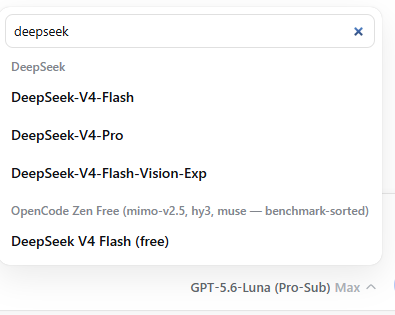

# Model Picker Search Filter for DeepSeek Harness

**Status: ✅ Production Ready - In Active Use**

A searchable composer model pane that adds filtering to the model selection dropdown.

## Features

- Auto-focuses a search field when the nested Model list opens
- Matches model name/id and provider name/id case-insensitively
- Preserves provider grouping
- Resets on close and includes localized empty-state copy
- Adds component coverage and English/Chinese documentation

## Screenshot

## Installation

### Option 1: Install from Git (Recommended)

`ash
npm install -g "https://github.com/WaldemarFech/deepseek-harness.git#feat/model-picker-alpha4"
`

### Option 2: Build from Source

`ash
# Clone the fork
git clone -b feat/model-picker-alpha4 https://github.com/WaldemarFech/deepseek-harness.git
cd deepseek-harness

# Install dependencies
npm install -g pnpm
pnpm install

# Build
pnpm run build

# Pack and install
npm pack
npm install -g ./deepseek-ai-dsh-root-*.tgz
`

## Usage

1. Start DSH web interface:
   `ash
   dsh web
   `

2. Click on the model selection dropdown in the composer

3. Type in the search field to filter models by:
   - Model name (e.g., "deepseek", "gpt", "claude")
   - Model ID (e.g., "deepseek-chat", "gpt-4")
   - Provider name (e.g., "openrouter", "opencode-zen")

4. The list filters in real-time as you type

## Compatibility

- ✅ DSH 0.1.2-alpha.4 (latest)
- ✅ DSH 0.1.2-alpha.3
- ✅ Works with all existing providers and plugins
- ✅ No configuration changes required

## Technical Details

### Branch Information

- **Branch:** eat/model-picker-alpha4
- **Based on:** upstream dsh-v0.1.2-alpha.4
- **Cherry-picked commits:**
  - 72a4f5c - feat(web): filter composer model list
  - 5d6492 - docs: add model picker filter screenshot

### Changes Made

- packages/client/ui-model-selection/src/client/ModelSelect.tsx - Added filter state and logic
- packages/client/ui-model-selection/src/client/ModelSelect.module.css - Added filter styling
- packages/client/ui-model-selection/src/client/locales.ts - Added localized strings

### How It Works

1. **Filter State:** A new modelFilter state variable tracks the search input
2. **Filtered Groups:** The model list is filtered based on the search term, matching against:
   - Model name
   - Model ID
   - Provider name
   - Provider ID
3. **Provider Grouping:** Filtered results maintain provider grouping
4. **Empty State:** Shows a localized message when no models match the filter

## Contributing

This feature is ready for upstream integration. If the maintainers want to include it:

1. Cherry-pick the commits from eat/model-picker-alpha4
2. Or manually apply the changes from the diff:
   [master...WaldemarFech:deepseek-harness:feat/model-picker-alpha4](https://github.com/WaldemarFech/deepseek-harness/compare/master...WaldemarFech:deepseek-harness:feat/model-picker-alpha4)

## License

Same as DeepSeek Harness - see [LICENSE](LICENSE) for details.
